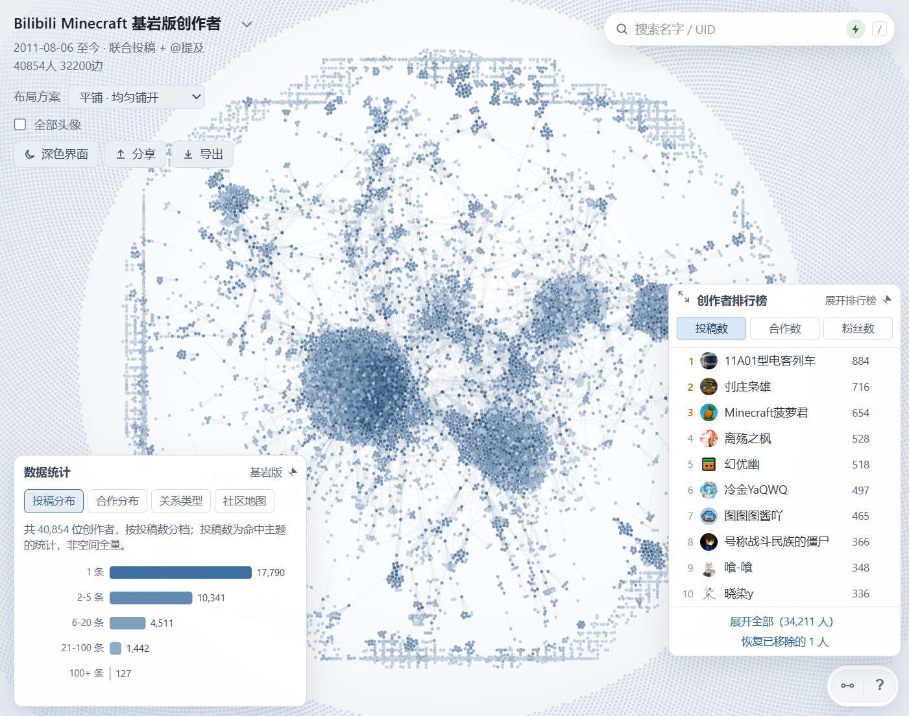
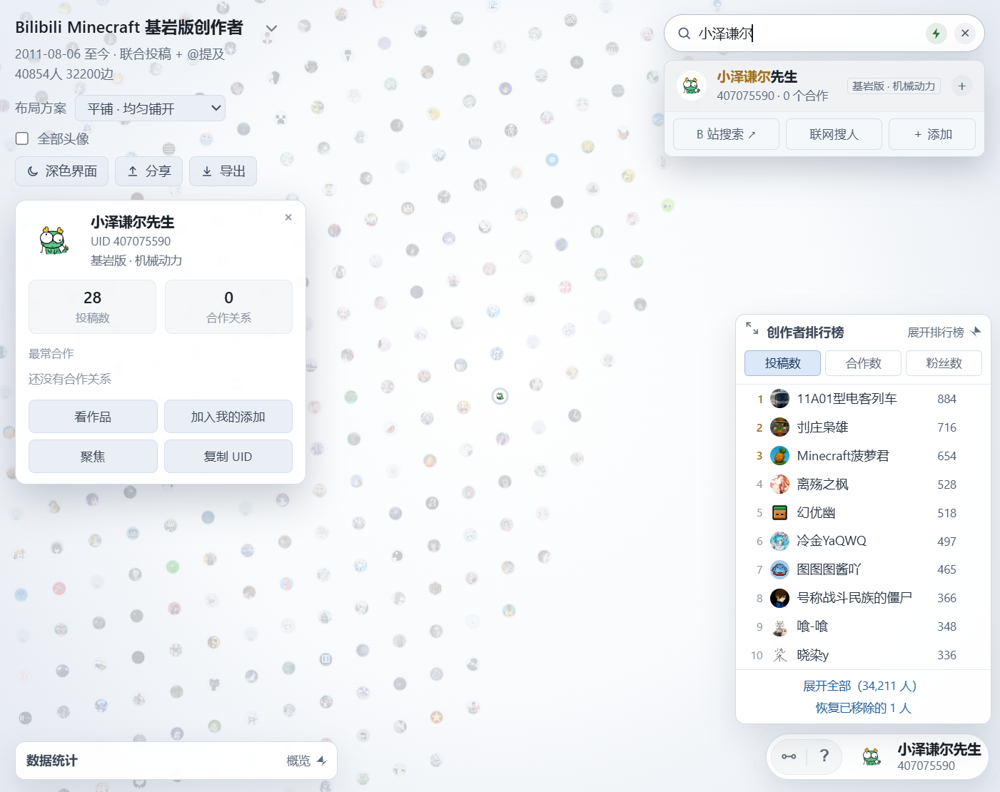
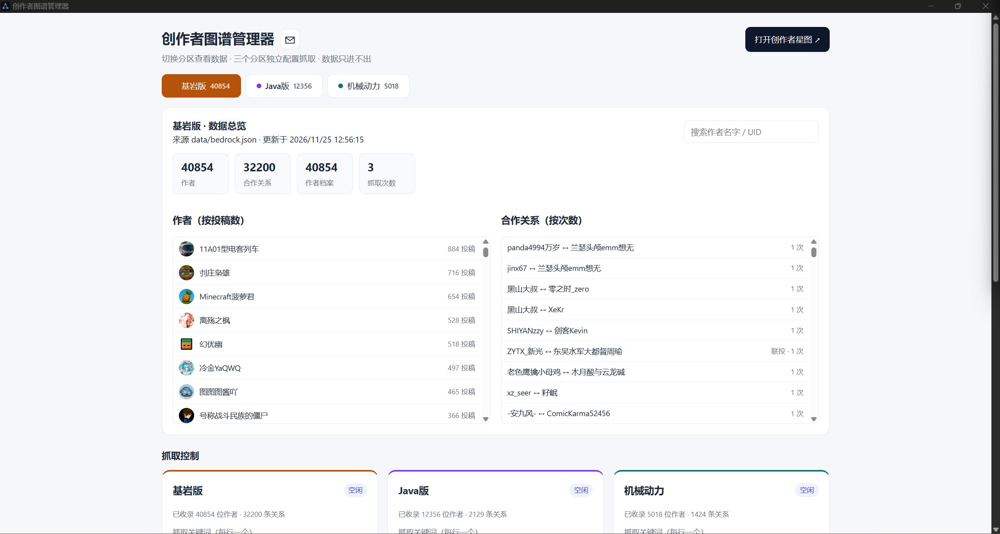
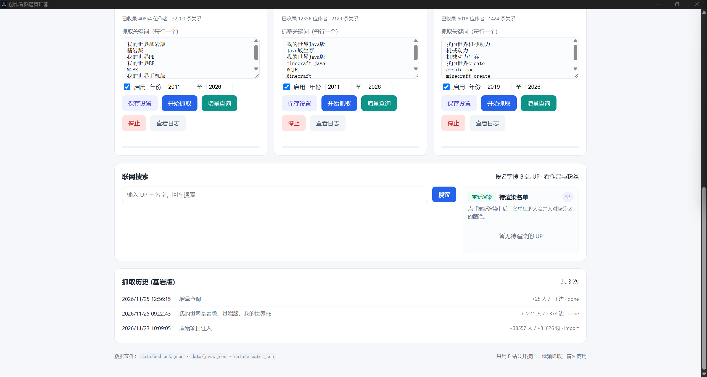

# B 站 Minecraft 创作者关系图

> 一张能拖着看、能搜人、能顺着合作线一路走下去的星图。
> 双击 `index.html` 就能打开，不用装软件，看图也不需要联网。

你想知道 B 站做 Minecraft 的人，平时都在跟谁一起拍视频吗？这张图把这些人、以及他们之间的每一次联合投稿和 @提及，连成了一张可以缩放、可以点开的网。点住一个人，你能看到他跟谁合作最多；输入一个名字，你能直接跳到他在图上的位置；想发一张图给别人，右下角点一下就能导出。

---

## 这张图的来历（原项目声明）

这张图不是从零做起的。它的数据、抓取思路和布局算法，都来自下面这个项目：

- **原项目**：`Bilibili-Minecraft-Bedrock-Edition-All-Bloggers-Relationship-Diagram`
- **原仓库**：<https://github.com/dreams6767867/Bilibili-Minecraft-Bedrock-Edition-All-Bloggers-Relationship-Diagram>
- **原项目介绍视频**：【我绘制了b站有史以来所有MCBEup主的关系图】<https://b23.tv/ZFL0UZP>
- **原仓库作者**：[@dreams6767867](https://github.com/dreams6767867)

原项目做的是「B 站基岩版（含携带版时代）创作者合作网络」：用 Python 爬虫回溯 B 站公开接口，按标题 / 简介 / 标签里的基岩信号筛出视频，再用联合投稿和可解析的 @提及把创作者连起来。它发布时的规模是 **17,418 位创作者、5,668 条合作边**，扫描过 134,487 条视频，并提供四种布局、时代切换和「连接两位创作者」。

**你正在看的这份，是在原项目基础上的扩展版，不是原项目维护者发布的版本：**

| 方面 | 原项目 | 这份扩展版 |
|---|---|---|
| 数据 | 基岩版 17,418 人 / 5,668 条边 | 基岩版 40,854 人 / 32,200 条边（在原项目数据上继续抓取），另加 Java 版、机械动力两个分区 |
| 桌面端 | 爬虫脚本 + 本地预览服务 | 一个免安装管理器 exe：抓取、增量、联网搜人、收件箱、渲染 |
| 前端 | 四种布局 + 搜索 + 连接两位 | 再加详情卡、排行榜、数据统计、我的添加、导出 PNG、深色模式 |
| 数据口径 | 公开接口 / 信号命中 / 联投 + @提及 / 2017-09-20 分时代 | **完全沿用，没有改判定标准** |

原仓库没有声明开源许可证，因此这里只做署名与致谢，不主张对原项目数据和算法的任何权利。如果你要二次使用，请同时遵守原仓库的说明。

---

## 一眼看懂：三张图，一个管理器

三个分区各自独立抓取、独立存储、独立布局，互不干扰。看哪张，左上角下拉框切一下就行。

| 分区 | 收录的是谁 | 规模 |
|---|---|---|
| **基岩版** | 手机 / 平板 / 主机上的 Minecraft（含 2017 年前的携带版时代） | 40,854 人 · 32,200 条合作 |
| **Java版** | PC Java 版创作者 | 12,356 人 · 2,129 条合作 |
| **机械动力** | 玩 Create（机械动力）模组的创作者 | 5,018 人 · 1,424 条合作 |

两样东西配合着用：

1. **星图页面**（`index.html`）——纯静态，双击就开，负责「看」
2. **创作者图谱管理器**（`创作者图谱管理器.exe`）——免安装桌面程序，负责「更新数据」和「联网查人」

只想看图，管理器完全不用碰。

---

## 打开它：三种方式

**① 网页版（若维护者已部署）**
直接打开网址即可，手机也能看。

**② 本地双击（最省事）**
双击项目根目录的 `index.html`。不需要 Python、不需要起服务；断网也能看结构，头像会退回首字母。三个分区的数据都在 `data/` 里，页面会自己读。

**③ 用管理器打开**
双击 `创作者图谱管理器.exe`，点右上角「打开创作者星图 ↗」，会用系统浏览器打开同一份页面。

> 管理器必须和 `creator-studio/` 文件夹待在同一层（配置和数据在那里），搬家时请整个文件夹一起搬。

---

## 最常用的六件事

**找一个人**
右上角搜索框输入昵称或 UID。排序是「UID 完全一致 → 名字完全一致 → 前缀匹配 → 包含」，同级按合作数从多到少，最多列出 12 条。用 `↑↓` 选、`Enter` 定位、`Esc` 清空、`/` 直接聚焦搜索框。人不在当前分区时会自动切过去。

**看一个人跟谁合作**
点画布上的节点（也可以从搜索结果、排行榜、详情卡里点），左侧弹出详情卡：头像、名字、UID、投稿数、合作数、所属圈子、最常合作的 Top5。点 Top5 里的人可以直接跳过去。

**看两个人的关系有多远**
右下角「连接两位创作者（最短路）」→ 依次点两个人，底部会告诉你隔了几跳、中间经过谁。再点一次或按 `Esc` 退出。

**看某人最近发了什么**
在节点上右键 →「查看作品（联网）」，会列出资料和最近 12 条投稿（BV/av 号、标题、封面、时长、播放、日期），点卡片跳 B 站。这条需要管理器在跑。

**导出成图片**
右上角导出按钮：2 倍像素渲染。如果你正聚焦某个人，导出的就是「他 + 一圈合作者」的小星图，并附一行说明文字，适合直接发动态。

**收藏在意的人**
搜索结果、联网结果、右键菜单里都能「加入我的添加」，图上会给这个人套一圈金环。收藏存在你自己的浏览器里，换设备不会同步。

---

## 界面上都有什么

**左上**：标题、分区下拉框（基岩版 / Java版 / 机械动力）、布局切换（平铺 / 层级 / 枢纽 / 社区）。基岩版还有「全部 / 携带版 / 基岩版」时代切换；另外两个分区没有时代划分，切换分区时会自动回到全部。

**右上**：全局搜索、「全部头像」开关（低缩放也画头像，吃内存，默认关）。

**左下**：数据统计面板（投稿分布、合作分布、关系类型、社区地图）与配色切换（白色 / 深色）。统计面板和详情卡都在左侧，打开一个会自动收起另一个，避免互相遮挡。

**右下**：排行榜（投稿数 / 合作数 / 粉丝数）、连接两位创作者、申请收录入口。

**画布**：滚轮缩放、拖拽平移、双击放大/复位、双指缩放、惯性滑动、悬停看名字。手机和平板上也能用。

---

## 先看几张实机截图

**星图总览（基岩版）**：40,854 位创作者、32,200 条合作线，平铺布局。左上角切分区、布局、配色；左下角是投稿数量分布，右下角是创作者排行榜。



**搜索与详情**：搜到的人会标出实际收录的分区（可以同时属于多个分区）；点开后是详情卡，能看到投稿数、合作数和「看作品 / 加入我的添加」等操作。



**管理器上半部分**：三个分区的数据总览、作者榜、合作关系榜，以及各自的抓取控制入口。



**管理器下半部分**：关键词与年份配置、联网搜索与「待渲染名单」侧栏，以及抓取历史。



> 截图取自本副本的实际页面；你本地打开时，人数和边数会以当时的 `data/` 为准。

---

## 前端在你屏幕上做了什么

星图页面由七个前端模块组成。对你来说，它们对应的是下面这些体验，不需要关心代码：

| 你在界面上做的事 | 页面给你的反馈 |
|---|---|
| 拖图、缩放、切分区 / 布局 / 时代 | 图立刻重排；切到 Java 版或机械动力时自动回到「全部」视图；布局有平铺、层级、枢纽、社区四种 |
| 右上搜索名字或 UID | 命中项按「UID 完全一致 → 名字完全一致 → 前缀 → 包含」排序，回车把人放到画面中央并放大；标签显示他实际收录的分区（与详情卡一致，可同时属于多个）；人不在当前分区会自动切过去 |
| 点一个人 | 左侧弹出详情卡：投稿数、合作数、所属圈子、最常合作的 5 个人；点其中任何一个可以直接跳过去 |
| 右键一个人 | 看他的资料和最近投稿，点卡片跳 B 站；资料会在本地缓存 6 小时，下次打开更快 |
| 看统计和排行榜 | 左下角统计面板展示投稿 / 合作分布、关系类型、社区划分；右下角排行榜按投稿数、合作数、粉丝数排；点 `×` 只从「你的」榜单移除，底部可一键恢复 |
| 点「加入我的添加」 | 图上给这个人套一圈金环，下次一眼就能找到 |
| 点导出 | 保存一张 2 倍像素 PNG；如果正聚焦某人，导出的是「他 + 一圈合作者」的小星图 |
| 发现图里少了一个人 | 右下角 `?` 提交申请收录，昵称或 UID 至少填一个 |

有两件事值得单独说：

- **你的操作只属于你**：收藏、隐藏名单、看过的作品、配色、缩放位置都存在当前浏览器里，不上传服务器，也不会影响别人；换设备或清缓存就会重置
- **看图不挑环境**：只有「联网搜人」「右键看作品」「真实头像导出」「申请收录」需要连上管理器或部署好的服务，其余功能双击页面就能用

（数据怎么读、布局怎么校验、状态存在哪些文件里，见附录 A。）

## 后台在帮你做什么

管理器 exe 里跑着一套本地服务。你看图的时候，它在背后处理这些事：

| 你点了一下 | 后台替你做的事 |
|---|---|
| 开始抓取 | 按关键词和年份去 B 站公开接口找视频，补抓漏掉的作者，抓详情、建合作边，最后合并进对应分区并重算布局；名字补抓每轮最多 300 人，剩下的自动留到下一轮 |
| 增量查询 | 只找最近的新视频，另外挑出长期没更新的老作者复查，不重复扫全库；复查每轮最多 200 人，没查过的优先 |
| 查看日志 | 实时显示每个阶段跑到哪、有没有被 B 站限流、已经抓了多少条 |
| 点停止 | 立即停下；风控等待时最多 2 秒退出，正在重算布局时会等这一步跑完，避免「数据更新了但布局没跟上」 |
| 联网搜人 / 看作品 | 代你访问 B 站接口并取回头像（浏览器自己请求会被跨域拦住）；结果缓存 5 分钟，和抓取共用请求间隔，减少被风控的机会 |
| 用 `+` 加入分区 | 先把人放进「待渲染名单」，不会马上改图谱；点「重新渲染」才真正并入并重算布局 |
| 点「重新渲染」 | 只重算一次实际布局（当前数据里「携带版」是空的、「基岩版」与「全部」相同），没有新增时不重算；进度条会显示阶段 |
| 提交申请收录 | 写进收件箱文件，管理器标题右侧的信封会亮红点 |
| 打开星图 | 用系统浏览器打开项目里的 `index.html` |

它还有两个让你少操心的习惯：

- **抓取可以续跑**：每完成一批就记断点，关掉管理器再开会从上次的位置继续，不会从头来
- **遇到限流会自己刹车**：B 站返回风控码时自动暂停、降速、重试；连续失败多次就结束本轮，已经抓到的数据和断点全部保住
- **断点会压缩存放**：抓取进度打包成 `.gz`，但从旧目录拷来的普通 JSON 也能直接接着读；Web 数据里不再重复放只有后端需要的字段，首屏更小

（这些能力分别由 `server.py`、`engine.py`、`store.py`、`bili.py`、`helper.py`、`throttle.py`、`signals.py`、`make_layouts.py` 实现，文件分工和接口清单见附录 A.11。）

**待渲染名单侧栏**：在「联网搜索」面板右侧，标题左边就是「重新渲染」按钮。每次用卡片上的 `+` 把 UP 加入一个或多个分区后，他会立刻出现在侧栏里，按分区分组显示头像、昵称、UID 和加入时间；每行末尾有 `✕`，可以只把他从**当前分区**的名单里移除（不影响其它分区里的同一个人）。点「重新渲染」并入图谱后名单自动清空，侧栏还会显示「上次渲染并入：基岩版 +2 · Java版 +1」这样的结果。这样你随时能看清"加进来了几个、都加到哪了、哪些还没生效"。

---

## 数据是怎么来的（以及它不保证什么）

数据全部来自 **B 站公开 Web 接口**，未登录状态抓取，只取视频基础信息、简介、标签、作者 UID/昵称/头像、联合投稿成员。图谱本身不存评论、弹幕和播放量，也不下载视频；联网看作品时显示的播放量只是临时取来展示，不写进图谱。

一条视频要进图，得同时满足两件事：被关键词或创作者名字召回，并且标题 / 简介 / 标签命中该分区的主题信号。边只有两种来源：**联合投稿**（staff 全员两两互连）和**简介里能解析出来的 @提及**（且对方也在图里）。发布时间早于 2017-09-20 的算携带版时代，之后算基岩版时代。

所以有几件事它做不到，提前说清楚：

- **某人的投稿数比他空间里少**：这里统计的是「命中主题、被召回」的投稿，不是他的全部作品
- **有人没被收录**：可能关键词没搜到、信号没命中，或者他确实没发过相关视频——右下角可以「申请收录」
- **私密、已删除、仅粉丝可见的视频拿不到**
- **数据只进不出**：重复抓取只刷新计数和时间，不删旧人，所以图会越来越大，偶尔也会留下已经退坑的账号
- **会有同名误判**：按名字补抓时用 mid 白名单防串号，但极端情况下仍可能有噪声

---

## 常见问题（看图的你）

**Q：为什么我关注的 UP 不在图里？**
A：先在上面搜一下 UID，确认不是分区切错了。确实没有的话，点右下角「连接两位创作者」旁边那个 `?`，填昵称或 UID 提交申请。昵称和 ID 至少填一个。

**Q：为什么他的投稿数不对？**
A：这个数字是「被收录的相关投稿数」，不是空间总投稿数。标题里不带主题词的视频不计入。

**Q：我的收藏、排行榜里删掉的人，别人会看到吗？**
A：不会。收藏、隐藏、作品缓存、配色、缩放位置全部存在你自己的浏览器 localStorage 里，不上传服务器，也不会影响别人。排行榜删掉的人可以在面板底部一键恢复。

**Q：头像是空白/字母？**
A：B 站头像 CDN 有防盗链，断网或图片被拦时会退回首字母圆点。不影响其他功能，导出时同样会降级成圆点。

**Q：手机上能看吗？**
A：能，支持双指缩放和拖动。但基岩版有 4 万多个点，中低端手机会有点烫，建议先切到机械动力或 Java 版试试。

**Q：数据多久更新一次？**
A：没有固定节奏，取决于维护者什么时候跑一次增量查询。星图页面不显示更新时间，管理器的数据总览里能看到「更新于 …」。

---

## 想自己跑一份（本地）

### 目录结构

```
bedrock-creators-web/
├── index.html                  星图页面（骨架 + 样式 + 分区下拉 + 排行榜等）
├── 创作者图谱管理器.exe        桌面管理器（双击运行，13MB）
├── images/                     页面与管理器截图（README 预览用）
├── js/                         前端模块（7 个）
│   ├── app.js                  画布渲染 / 手势 / 头像 / 分区与布局切换 / 导出
│   ├── search.js               全局搜索（名字 / UID）
│   ├── online.js               我的添加 / 联网搜人 / 右键菜单 / 作品弹窗
│   ├── rank.js                 排行榜（投稿数 / 合作数 / 粉丝数）
│   ├── stats.js                数据统计面板
│   ├── apply.js                申请收录 UP（POST /api/apply）
│   └── detail.js               人物详情卡
├── data/                       成品数据（三分区统一放在这里）
│   ├── bedrock.json / .bundle.js    基岩版图谱（40,854 人 / 32,200 边）
│   ├── java.json / .bundle.js       Java版图谱（12,356 人 / 2,129 边）
│   ├── create.json / .bundle.js     机械动力图谱（5,018 人 / 1,424 边）
│   ├── uid_topics.json / .bundle.js UID → 分区标记（详情卡显示实际收录分区）
│   ├── layouts_bedrock/             基岩版预计算布局（4 个 json + 4 个 bundle）
│   ├── layouts_java/                Java版布局（同上）
│   └── layouts_create/              机械动力布局（同上）
├── creator-studio/             管理器源码与配置
│   ├── server.py               HTTP 服务 + 原生窗口 + API
│   ├── engine.py               抓取引擎（搜索 / 名字补抓 / 增量 / 详情 / 建边 / 合并 / 布局）
│   ├── store.py                数据读写 / 合并 / 断点状态
│   ├── bili.py                 B 站接口封装（WBI 签名 / 风控刹车 / 重试）
│   ├── signals.py              主题命中判定（strong / weak / context / other_game）
│   ├── helper.py               联网搜索服务
│   ├── make_layouts.py / layout_orig.py   预计算布局生成（沿用原项目算法）
│   ├── config.json             三分区配置 + 全局阈值
│   ├── web/                    管理器前端（index.html / app.js / style.css）
│   ├── state/<主题>/           抓取断点与日志
│   ├── state/pending_adds.json 待渲染清单（联网搜索「+」加入的人）
│   ├── apply_list.txt          申请收录消息（一行一条）
│   └── apply_read.json         申请消息已读状态
└── .gitignore
```

前端只用原生 API（Canvas 2D、Pointer Events、Promise、localStorage），没有框架、没有构建步骤，改完刷新就生效。

### 为什么每份数据都有 `.json` 和 `.bundle.js` 两份

浏览器不允许 `file://` 页面用 `fetch` 读本地 JSON（同源策略），但 `<script>` 不受限制。所以每个 JSON 旁边都放了一份内容完全相同的 `*.bundle.js`（形如 `window.XXX = {...}`）。页面按 `location.protocol` 自动选：双击打开读 bundle，走 http 读 JSON，画面一模一样。**这两份必须同步写**，抓数据和生成布局时都会一起写。

### 管理器里能做什么

- 切分区，看作者数、合作数、抓取历史
- 配关键词和年份，点「开始抓取」或「增量查询」
- 联网搜 UP、看投稿；结果卡片右侧的「+」可以把他加进一个或多个分区，右侧「待渲染名单」会立刻列出这些人，渲染完成后自动清空
- 标题右侧的**收件箱**：读星图页面提交的「申请收录」，有未读时显示红点，支持一键已读/未读
- 「联网搜索」面板右侧、**待渲染名单标题左边**的「重新渲染」：把 `+` 加进来的人真正并进图谱并重算布局。渲染是后台任务，面板顶部有百分比进度条，完成后自动刷新，渲染期间可以继续用别的功能
- 首次拿到的 exe 就在项目根目录，双击即用；老系统缺 WebView2 时会自动降级成浏览器打开，功能一样

### 联网功能的前提

「联网搜人」和「右键看作品」需要后端帮忙，因为 B 站接口不返回 CORS 头，浏览器直接请求会被 403。页面会按打开方式自动选地址，你不用手动配：

- **双击 `index.html`（`file://`）**：连本机管理器 exe 的 `127.0.0.1:8788`，没启动时会提示「请打开创作者图谱管理器.exe」
- **走 http(s)（自己部署或用本地服务）**：改成同源相对路径（`/ping`、`/search`、`/card`、`/videos`、`/img`），由反向代理转给后端，不暴露后端地址；localStorage 里残留的旧地址会自动忽略

看图、本地搜索、收藏、排行榜、跳 B 站都不依赖联网服务。

---

# 附录 A：数据结构与抓取逻辑（给维护者）

## A.1 图谱 JSON（`data/<主题>.json`）

三份结构完全一致，与原项目 `build_graph.py` 的输出兼容：

```json
{
  "topic": "create", "label": "机械动力", "updated": 时间戳,
  "nodes": [
    { "id": "mid", "name": "昵称", "face": "头像URL",
      "pe": 0, "br": 1, "vpe": 携带版投稿数, "vbr": 基岩版投稿数 }
  ],
  "links": [
    { "source": "mid1", "target": "mid2", "pe": 0, "br": 1, "j": 1 }
  ],
  "creators": {
    "mid": { "name": "...", "face": "...", "v": 投稿数,
             "first": 最早投稿时间戳, "last": 最近投稿时间戳,
             "sources": ["命中关键词"] }
  },
  "history": [
    { "ts": 时间戳, "keywords": [...], "new_creators": 新增, "new_edges": 新增 }
  ],
  "eraSplit": "2017-09-20"
}
```

- `links.j`：`1` = 含联合投稿（staff 全员两两互连），`0` = 仅 @提及
- `eraSplit`：携带版 / 基岩版分界（携带版诞生于 2011-08-06）
- 只进不出：重复抓取只刷新计数和时间，`history` 只追加（保留最近 500 条）
- 一主题一文件：抓取完成只原子替换该主题那一个 JSON

> 成品图谱没有单条视频的年份字段。逐年统计要看 `state/<主题>/videos.json` 里的 `pubdate`；基岩版早期数据是从原项目迁入的，那部分没有逐条视频缓存，后续增量抓取的才有。

## A.2 预计算布局（`data/layouts_<主题>/`）

每个主题 8 个文件：`all × {flat,comm,hierarchy,hub}`，各有 `.json` 和 `.bundle.js`：

```json
{ "count": 节点数, "hash": "节点ID序列的fnv哈希",
  "x": [全部节点x坐标], "y": [全部节点y坐标], "group": [社区分组] }
```

前端切换时代 / 布局时用 `count` + `hash` 校验，不匹配就提示「布局加载失败」。所以**数据一变就必须重算布局**，管理器会自动做。

## A.3 抓取断点（`creator-studio/state/<主题>/`）

| 文件 | 内容 |
|---|---|
| `videos.json` | 视频池：`bvid → {mid,author,title,desc,pubdate,tag,kw,source}` |
| `details.json` | 视频详情：`bvid → {owner,staff,title,desc,pubdate}`，失败的带 `err` 下次重试 |
| `faces.json` | 头像缓存 |
| `search_done.json` | 搜索分页断点：`关键词\|年份\|排序\|页` 与 `...\|END` |
| `space_videos.json` / `space_done.json` | 名字补抓候选与已处理名字 |
| `incremental_checked.json` | 增量复查时间戳：`mid → 上次复查时间` |
| `crawl.log` | 抓取日志（管理器弹窗读的就是它） |

断点让抓取可以续跑；删掉某个断点文件，就让对应阶段重新跑。

## A.4 完整抓取流水线

1. **搜索召回**：关键词 × 年份切片调 B 站搜索接口，按 bvid 去重（年份切片是为了绕开单次查询约 1000 条的上限）
2. **名字补抓**：从已命中视频（含 staff）收集创作者名字，以名字为关键词按发布时间再搜一遍，补回关键词排名漏掉的投稿。按名字记断点，每人最多 5 页。这一步解决「某人有好几条主题视频、关键词只召回了个别」的问题
3. **主题判定**：`strong` 强信号命中即入图；`weak` 弱信号要配合 `context` 语境；命中 `other_game` 直接排除
4. **抓详情**：只对命中视频和带合作信号的视频抓 staff 全员、简介、头像
5. **建边**：联合投稿（staff 两两互连，`j=1`）+ @提及（解析名字反查图内作者，`j=0`）
6. **合并落盘**：并入该主题 JSON、追加历史，**重算该主题布局并校验 hash**

## A.5 增量查询（两段式，D+E 策略）

一次点击完成「发现新人 + 复查老人」，再接上详情、建图、合并、布局：

**D 策略（锚点起点）**：锚点 = 已知视频的最大 `pubdate`，搜索带 `pubtime_begin_s = 锚点+1`、`order=pubdate`，服务端只返回锚点之后的新视频。
**E 策略（追平即停）**：连续 N 页没有「属于该对象且比锚点更新」的新视频就提前停；每个对象最多翻 M 页兜底。

1. **段 1 · 关键词增量发现**（每次都跑）：对每个关键词按 D+E 搜，锚点取该 `kw` 在 `videos.json` 里的最大 pubdate；新视频写入（`source=增量发现`），其中没见过的 mid 就是全新 UP
2. **段 2 · 老 UP 复查**（严格双闸门）：名单只取**已入图创作者**；筛出「最近一个视频距今超过 90 天」且「距上次复查也超过 90 天」的沉寂 UP——纯本地筛选，零请求；逐个按名字搜，mid 白名单防同名串号；成功（含空结果/追平）才记 `incremental_checked[mid]`，失败不记，下轮重试
3. **段 3 · 共用下游**：新视频走详情 → 建边 → 合并 → 重算布局，不动 `phase_search` / `phase_space` 的断点

近期还在更新的 UP 由段 1 的关键词发现负责，不重复查。

## A.6 连续异常熔断

所有网络请求点都监控失败：重试耗尽（返回 `None`）、风控码（`-412/-352/-799/-403/412`）计入连续异常；`code=0` 或正常业务码（如 62002「稿件不可见」、`-404`）清零计数。**连续失败达到 `net_fail_limit`（默认 5）立即熔断本轮**，已抓数据和断点全部保留，下次续跑。日志会逐次记录「网络异常累计 N/5」。

停止按钮是协作式的：点一下只是设置停止标记，线程走到下一个检查点才退出。**风控等待循环已改为每 2 秒检查一次**，所以遇到 180 秒刹车时点停止最多等 2 秒；但**重算布局阶段不检查停止标志**，会等它跑完——这是为了保证「数据变了、布局也跟着变」，否则页面会因为 hash 不匹配而白屏。界面状态每 4 秒刷新一次，按钮变灰可能再滞后几秒。

## A.7 配置（`creator-studio/config.json`）

每个分区一块（关键词、年份、并发、详情间隔、信号词），顶层是全局阈值：

```json
{
  "bedrock": { "keywords": [...], "years": [2011,2026], "workers": 8, "signals": {...} },
  "java":    { ... },
  "create":  { ... },
  "incremental_interval_days": 90,
  "incremental_pages_max": 5,
  "incremental_catchup_pages": 2,
  "incremental_recheck_max": 200,
  "space_names_max": 300,
  "net_fail_limit": 5
}
```

主题命中判定示例（机械动力）：

```json
"signals": {
  "strong": ["机械动力", "create\\s*mod", "contraption"],
  "weak": ["齿轮", "传送带", "蒸汽", "自动化"],
  "context": ["我的世界", "minecraft", "方块", "生存"],
  "other_game": ["迷你世界", "蛋仔派对", "原神"]
}
```

正则语法，改完重启程序生效。端口用环境变量 `CREATOR_STUDIO_PORT` 改（默认 8788）。

## A.8 数据更新问答

- **重跑「开始抓取」会真的重抓吗？** 不会。断点满了就是空转，搜索和详情全跳过。要全量重抓，得手动删 `state/<主题>/` 下对应断点
- **增量会重复查老 UP 吗？** 查完记时间戳，90 天内不再查
- **新 UP 会被发现吗？** 会。段 1 每次都搜最新视频；历史投稿由段 2（没有复查记录的新 UP）补
- **只进不出**：抓取从不删旧数据，计数取 `max`，「更新」是增量补充而不是刷新快照
- **完整抓取会标记复查时间**：正常跑完后把所有入图创作者记为「今日已查」，紧接着点增量不会重复查；熔断/用户停止时不标记
- **点停止后没立刻变灰？**：风控等待最多 2 秒生效；若日志停在「重算布局」，要等布局算完才会退出（强行中断会留下不匹配的数据和布局）

## A.9 开发与打包

源码运行（管理器）：

```bash
cd creator-studio
python server.py                 # 默认 8788，可设 CREATOR_STUDIO_PORT
```

重新打包 exe（在 `creator-studio/` 下执行，产物拷到项目根目录）：

```bash
python -m PyInstaller --onefile --noconsole --clean \
  --name "创作者图谱管理器" \
  --add-data "web;web" \
  --hidden-import=webview --hidden-import=pythonnet --hidden-import=clr \
  --hidden-import=make_layouts --hidden-import=layout_orig --hidden-import=throttle \
  --collect-all=webview --icon=app.ico server.py
```

手动重算某分区布局：

```bash
cd creator-studio
python make_layouts.py ../data/create.json ../data/layouts_create
```

**打包踩过的坑（改代码时务必注意）：**

1. frozen 下 `sys.executable` 是 exe 自身，不能拿它起子进程跑 `.py`——布局模块已打进包，frozen 时改成进程内 `import make_layouts`
2. `--noconsole` 下 `sys.stdout` 可能是 `None`，`make_layouts.py` 顶部已做保护；`engine.log()` 的 `print` 也包了 `UnicodeEncodeError`（特殊昵称会打崩）
3. PyInstaller onefile 内嵌模块偶发 zlib -3（解压竞争）：布局重算有「重试 + 外部 Python 兜底 + hash 校验」三层保护，且绝不静默失败
4. 命令末尾必须带 `server.py`，否则报 `scriptname required`；管道 `tail` 会吞掉退出码，注意确认
5. 布局 json 和 bundle 必须同步写，否则 `file://` 模式读旧布局会白屏
6. 必须带 `--hidden-import=make_layouts --hidden-import=layout_orig`，否则布局重算失效
7. **`creator-studio/web/` 里的前端也打进了 exe**：改了管理器界面（比如待渲染名单侧栏）必须重新打包，exe 才会生效；源码方式 `python server.py` 直接读 `web/` 目录，不用打包。星图页面的 `index.html` / `js/` 是独立的，刷新浏览器即生效

## A.10 与原项目的技术差异

| 方面 | 原项目 | 这里 |
|---|---|---|
| 看图方式 | 必须起 Python 本地服务（8765） | 纯静态，双击 `index.html`；JSON 旁生成 bundle 兜底 `file://` |
| 数据分区 | 单一 `graph.json` | 三分区独立：`bedrock.json` / `java.json` / `create.json`，抓到哪写哪、页面读哪 |
| 基线图谱 | `graph.json` 由爬虫维护 | 基准快照不再随本工程分发；基岩版页面直接读 `bedrock.json` |
| 联网功能 | 独立 `bili_helper.py` | 并入 `helper.py`，复用 `bili.py` 的 WBI 签名与风控 |
| 抓取组织 | `crawl.py` 四阶段、全局状态 | `engine.py` 单主题引擎，状态隔离在 `state/<主题>/`，断点续跑 |
| 补抓遗漏 | `space_videos.json` 名字枚举 | 保留名字补抓，另加 D+E 增量（发现新 UP + 复查沉寂老 UP） |
| 稳定性 | 412 刹车 | 保留刹车，新增连续网络异常熔断（默认 5 次） |
| 布局 | 固定 `layouts/`，数据变要手动重算 | 每主题 `layouts_<主题>/`，抓取后自动重算、hash 校验、三层兜底、json + bundle 双写 |
| 前端 | 基础画布 + 搜索 + 连接两位 | 再加详情卡、排行榜、统计面板、我的添加、联网作品面板、导出、配色 |
| 桌面端 | 无 | 免安装 exe：分区配置、完整抓取、增量、实时日志、联网搜索、一键打开星图 |

## A.11 后端文件与接口速查

| 文件 | 职责 |
|---|---|
| `server.py` | HTTP 路由 + 原生窗口；渲染是异步任务，后台线程按阶段上报进度 |
| `engine.py` | 抓取引擎：关键词召回、名字补抓、增量、详情、建边、合并、断点、`stop_topic()` |
| `store.py` | 图谱读写：原子替换、只进不出合并、写盘后自动重建 `uid_topics.json` |
| `bili.py` | B 站接口封装：真实 buvid、WBI 签名、重试、412 风控刹车 |
| `helper.py` | 星图页的只读联网服务：搜 UP / 名片 / 投稿 / 头像代理，5 分钟缓存 |
| `throttle.py` | 抓取与联网助手共用的全局请求节流（0.35 秒），避免同一出口 IP 自己触发风控 |
| `migrate_from_old.py` | 备用迁移脚本：把旧目录的数据/断点/收件箱并进来，默认干跑 |
| `signals.py` | 主题命中判定（`strong` / `weak` / `context` / `other_game`） |
| `make_layouts.py`、`layout_orig.py` | 沿用原项目布局算法，生成四种布局并做 hash 校验 |
| `web/` | 管理器自己的界面（不是星图页面） |

全部接口（都是本机调用；上线时**只**该把 `/api/apply` 和 `/ping /search /card /videos /img` 转出去）：

| 用途 | 接口 |
|---|---|
| 页面读取配置 / 状态 / 数据 / 日志 | `GET /api/config`、`/api/status`、`/api/data/<分区>`、`/api/log` |
| 抓取控制 | `POST /api/crawl`、`/api/incremental`、`/api/stop` |
| 打开星图 | `POST /api/open-visual` |
| 申请收录与收件箱 | `POST /api/apply`、`/api/apply-read`；`GET /api/applies` |
| 待渲染名单与重新渲染 | `GET|POST /api/pending-add`、`POST /api/pending-remove`、`POST /api/render`、`GET /api/render-status` |
| 星图页联网功能 | `GET /ping`、`/search`、`/card`、`/videos`、`/img` |

## A.12 v3.0 优化副本与迁移

这份是**优化副本**，原项目 `bedrock-creators-web/` 保持不动。已做的改动：

- 布局按「节点序列 + 边序列」签名去重：当前数据里 `pe` 是空视图、`br` 与 `all` 完全相同，只算一次再复用，重算布局约省 2/3 时间；`all_*` 输出与原算法逐字节一致
- 抓取合并后没有新增节点/边时，跳过布局重算（空转增量从分钟级降到秒级）
- 抓取断点支持 `.gz` 双读：明文优先，没有明文再读归档；状态文件已压缩，磁盘从 306 MB 降到约 120 MB（后来抓取产生的新断点已再次归档，另含 2.7 MB 展示截图）
- 增量查询加每轮上限：`incremental_recheck_max=200`、`space_names_max=300`，未查过的优先，其余留断点下轮继续
- 清除了 `data/bedrock.json.tmp`（中断抓取残file）
- 页面不再有时代切换，`pe`/`br` 布局文件从未被读取；`make_layouts.py` 现在只生成 `all_*`，三个分区共删掉 48 个死文件，渲染少写 16 个文件
- 力导向的远场斥力只算邻近粗网格，碰撞松弛只移动核心节点（孤立点只参与避让）；机械动力分区截图对比无明显退化
- 风控探测结果缓存 10 分钟；抓取与联网助手共用全局节流，减少 412 刹车
- `creators` 元数据移到 `state/<分区>/creators.json`，Web 图谱文件体积减半；`index.html` / `js/` 双击模式不受影响

**新数据已经在本副本里抓取完成，不需要再迁移**。下面命令只作为以后从旧目录并数据的备用：

```bash
cd creator-studio

# 1) 先干跑预览，看看会动哪些文件
python migrate_from_old.py --old "D:/软件备份/up云/bedrock-creators-web"

# 2) 确认无误再真正执行
python migrate_from_old.py --old "D:/软件备份/up云/bedrock-creators-web" --apply
```

脚本只搬**数据、断点、收件箱、待渲染名单**，不会覆盖本副本的代码；申请消息按行去重追加，待渲染名单按 `(分区, UID)` 合并。布局只有在 `count/hash` 与图谱一致时才复制，不一致会打印 `WARN` 并跳过——这时在本副本手动重算即可：

```bash
python make_layouts.py ../data/bedrock.json ../data/layouts_bedrock
python make_layouts.py ../data/java.json ../data/layouts_java
python make_layouts.py ../data/create.json ../data/layouts_create
```

迁移后校验：三个分区页面能切换、详情卡分区标签正常、`/api/render` 加一个人能正常重算。

---

# 附录 B：想挂到网上（部署指南）

本地看图只要双击，但如果你想把这个链接发给别人、或者放到公网让所有人看，就需要一台服务器。

先说结论，免得白折腾：

- **只放静态文件**，看图、搜索、排行榜、收藏、导出全都能用，**联网搜人、右键作品、申请收录**用不了，导出图里的头像会变成字母圆点
- 想要完整功能，就得把 `server.py` 跑起来，并让 Web 服务器把指定的几个路径转给它
- 无论哪种，**别把 8788 端口直接开到公网**：那一侧是管理器后台，管理接口没有鉴权

## 0. 先选形态

| 形态 | 需要什么 | 你能得到什么 | 适合谁 |
|---|---|---|---|
| **A. 全功能** | 1 台云服务器 + Web 服务器 + 跑 `server.py` | 看图 / 搜人 / 看作品 / 申请收录 / 带头像导出 | 想公开、想要完整体验 |
| **B. 纯静态** | 任意静态托管（OSS、Vercel、GitHub Pages、宝塔静态站） | 看图 / 本地搜索 / 排行榜 / 导出（圆点头像） | 只想分享图谱 |
| **C. 静态 + 后端拆分** | 静态上 CDN，接口单独一台 | 同 A | 访问量比较大 |

两个绕不开的约束：

1. `server.py` 的监听地址写死为 `127.0.0.1`，只有端口能用 `CREATOR_STUDIO_PORT` 改。所以**后端必须和 Web 服务器在同一台机器**（不同机只能走 SSH 隧道，见 §3.5）
2. 页面全部用相对路径 + 同源请求，**静态文件和接口必须在同一个域名下**，别搞 `a.com` 放页面、`b.com` 放接口

## 1. 上线前准备

1. **域名**（可选但强烈建议）：`graph.example.com`
2. **服务器**：Linux（Ubuntu 22.04 / Debian 12）或 Windows Server，配置见 §6
3. **备案**：服务器在中国大陆并绑域名 → 必须完成 ICP 备案；中国香港 / 境外服务器免备案
4. **HTTPS 证书**：Let's Encrypt 免费，`certbot` 一条命令
5. **本地成品**：项目根目录的 `index.html`、`js/`、`data/`

### 需要上传的文件（约 32 MB）

```
index.html
js/                 (7 个 .js，159 KB)
data/               (约 32 MB，不含断点)
  ├─ bedrock.json / java.json / create.json          三分区图谱
  ├─ *.bundle.js                                       file:// 回退用，线上可不传但建议保留
  ├─ uid_topics.json / .bundle.js                     详情卡"实际收录分区"
  └─ layouts_bedrock/ layouts_java/ layouts_create/   每区 4 个布局
creator-studio/     （要用联网后端才传，见 §3.2）
```

**不用传**：`创作者图谱管理器.exe`（除非你要在服务器上抓取）、`.git/`、`creator-studio/state/`（抓取断点，压缩归档后约 72 MB）。
中断抓取的残file `data/bedrock.json.tmp` 与原项目基准快照 `graph.json` 都已从本工程移除，不需要传。

```bash
# 在项目根目录执行；--exclude 按需删
rsync -avz --progress \
  --exclude '.git' --exclude '*.exe' --exclude 'creator-studio/state' \
  ./index.html ./js ./data \
  root@1.2.3.4:/opt/creator-graph/
```

## 2. 方案 B：纯静态（5 分钟）

把 `index.html`、`js/`、`data/` 原样放到站点根目录就行。三个要点：

1. **位置固定**：页面用 `data/xxx.json` 相对路径，放子目录（如 `/graph/`）也能用，只要层级不变
2. **必须开 gzip**：`bedrock.json` 原始 8.3 MB，压缩后 2.2 MB；不开压缩首屏会很难等
3. **`.json` 要返回 `application/json`**：多数静态托管默认就对；宝塔 / Nginx 若把 JSON 当下载，需要补 MIME

这个形态下会**降级但不报错**：

- 联网搜人 / 右键作品 → 提示「请打开创作者图谱管理器.exe」（因为同源 `/ping` 是 404）
- 申请收录 → 提交后提示失败
- 导出图片 → **仍然能导出**，头像降级为首字母圆点
- 搜索、排行榜、详情卡、统计、收藏 → 全部正常

## 3. 方案 A：全功能（Linux + Nginx + server.py）

### 3.1 装环境

```bash
apt update && apt install -y nginx python3 rsync
# server.py 只用标准库；pywebview 只有桌面窗口需要，服务器上用 --no-window 不装也行
python3 -V     # 建议 3.10+
```

### 3.2 放后端代码

```bash
mkdir -p /opt/creator-graph
# 上传 creator-studio/ 到 /opt/creator-graph/creator-studio/
# 目录必须可写：申请收录要写 apply_list.txt，重新渲染要写 state/ 和 data/
chown -R www-data:www-data /opt/creator-graph
```

先手动跑一次，确认能起：

```bash
cd /opt/creator-graph/creator-studio
python3 server.py --no-window
# 另开一个终端：
curl -s http://127.0.0.1:8788/ping
# 期望：{"ok": true, "version": "manager/1.0"}
```

`--no-window` 是关键：不加它会尝试开原生窗口，服务器没桌面环境会走「降级打开浏览器」分支，服务能起但日志会报错。

### 3.3 注册成系统服务（开机自启 + 崩溃重启）

`/etc/systemd/system/creator-graph.service`：

```ini
[Unit]
Description=Creator Graph helper (server.py)
After=network.target

[Service]
Type=simple
User=www-data
WorkingDirectory=/opt/creator-graph/creator-studio
ExecStart=/usr/bin/python3 /opt/creator-graph/creator-studio/server.py --no-window
Environment=CREATOR_STUDIO_PORT=8788
Restart=always
RestartSec=3
StandardOutput=append:/var/log/creator-graph.log
StandardError=append:/var/log/creator-graph.log

[Install]
WantedBy=multi-user.target
```

```bash
systemctl daemon-reload
systemctl enable --now creator-graph
systemctl status creator-graph --no-pager
curl -s http://127.0.0.1:8788/ping
```

> `server.py` 启动时会 `os.chdir(BASE)`，数据路径锚定在 `creator-studio/` 下，所以整个目录要一起搬，不能只搬 `.py`。

### 3.4 Nginx 配置（静态 + 反代 + 压缩 + 缓存）

`/etc/nginx/sites-available/creator-graph`：

```nginx
# /img 头像代理缓存（可选但强烈建议，B 站头像重复率很高）
proxy_cache_path /var/cache/nginx/avatar levels=1:2 keys_zone=avatar:10m
                 max_size=1g inactive=7d use_temp_path=off;

# 申请表流控
limit_req_zone $binary_remote_addr zone=apply:10m rate=6r/m;

server {
    listen 80;
    server_name graph.example.com;
    root /opt/creator-graph;
    index index.html;
    charset utf-8;

    # ---- 压缩：必须开，否则首屏 8.3 MB ----
    gzip on;
    gzip_comp_level 6;
    gzip_min_length 1024;
    gzip_vary on;
    gzip_types text/plain text/css application/javascript application/json
               image/svg+xml application/xml;

    # ---- 页面与脚本 ----
    location = /index.html {
        add_header Cache-Control "no-cache";
    }
    location /js/ {
        expires 7d;
        add_header Cache-Control "public";
    }

    # ---- 数据：允许缓存但每次回源校验（304）----
    # 重新抓取/渲染后客户端能立刻拿到新数据，又不会重复下载 8.3 MB
    location /data/ {
        add_header Cache-Control "no-cache";
        try_files $uri =404;
    }

    # ---- 公开接口：页面只用到 /api/apply，其余 /api 全部封掉 ----
    location = /api/apply {
        limit_req zone=apply burst=3 nodelay;
        client_max_body_size 64k;
        proxy_pass http://127.0.0.1:8788;
        proxy_set_header Host $host;
        proxy_set_header X-Real-IP $remote_addr;
        proxy_read_timeout 30s;
    }

    # 管理类接口（抓取/配置/日志/收件箱）一律不对外
    location /api/ {
        return 404;
    }

    # 联网搜索四件套 + 心跳，路径原样转发（proxy_pass 后不要加 URI）
    location = /ping   { proxy_pass http://127.0.0.1:8788; }
    location = /search { proxy_pass http://127.0.0.1:8788; proxy_read_timeout 20s; }
    location = /card   { proxy_pass http://127.0.0.1:8788; proxy_read_timeout 20s; }
    location = /videos { proxy_pass http://127.0.0.1:8788; proxy_read_timeout 20s; }

    location = /img {
        proxy_pass http://127.0.0.1:8788;
        proxy_cache avatar;
        proxy_cache_valid 200 7d;
        proxy_cache_key $request_uri;
        add_header X-Cache-Status $upstream_cache_status;
    }

    location / {
        try_files $uri $uri/ /index.html;
    }
}
```

启用并签证书：

```bash
ln -s /etc/nginx/sites-available/creator-graph /etc/nginx/sites-enabled/
nginx -t && systemctl reload nginx
apt install -y certbot python3-certbot-nginx
certbot --nginx -d graph.example.com        # 自动改 80→443 并续期
```

**为什么把 `/api/` 整段封掉、只留 `/api/apply`：** 管理器那套接口（`/api/config` 改关键词、`/api/crawl` 触发抓取、`/api/render` 重算布局、`/api/log` 读日志、`/api/data/*` 读全量数据）**没有鉴权**。原设计只监听 `127.0.0.1`，天然只有本机能访问；整体反代出去，等于任何人都能改你的配置、用你的出口 IP 去抓 B 站。公开页面实际只调用 `/api/apply` 一个，按上面最小暴露就行。

要在外面看收件箱，给这两条单独加 Basic Auth（页面不调用，不影响访客）：

```nginx
location = /api/applies {
    auth_basic "admin"; auth_basic_user_file /etc/nginx/.htpasswd;
    proxy_pass http://127.0.0.1:8788;
}
location = /api/apply-read {
    auth_basic "admin"; auth_basic_user_file /etc/nginx/.htpasswd;
    proxy_pass http://127.0.0.1:8788;
}
# 生成密码：apt install apache2-utils && htpasswd -c /etc/nginx/.htpasswd admin
```

### 3.5 后端真的不能同机怎么办

监听地址写死 `127.0.0.1`，只能把远端端口「搬」到本机：

```bash
ssh -N -L 8788:127.0.0.1:8788 user@backend-host
# 配 autossh / systemd 保活；或后端用 socat 转发
```

不推荐，多一跳、排查更难。能同机就同机。

### 3.6 防火墙

```bash
ufw allow 22,80,443/tcp
ufw enable
# 8788 绝对不要放行；确认外网打不开：
curl -m 3 http://<公网IP>:8788/ping   # 期望超时/拒绝
```

### 3.7 不想直接开 80/443：Cloudflare Tunnel

如果你觉得源站直接暴露在公网不放心，可以让 `cloudflared` **主动向外**建一条隧道，服务器一个入站端口都不开，公网也扫不到你的 IP：

1. 域名托管到 Cloudflare（免费版够用）
2. Zero Trust → Tunnels → 新建隧道 → Public Hostname：`graph.example.com` → `http://127.0.0.1:8080`
3. 让 Nginx 或 Caddy 只监听本机高端口（`listen 127.0.0.1:8080;`），**不要**监听 80/443
4. 服务器上装服务：`cloudflared service install <TUNNEL_TOKEN>`，防火墙恢复全部入站拒绝

好处是源站 IP 隐藏、自带 DDoS 防护、自动 HTTPS，还能在 Cloudflare 上给 `/api/apply`、`/search` 单独做速率限制。代价是多一层依赖，域名必须托管在 Cloudflare。

### 3.8 上线验收清单

| # | 检查 | 期望 |
|---|---|---|
| 1 | 打开 `https://域名/` | 星图正常渲染，左上角三分区可切 |
| 2 | DevTools → Network | `bedrock.json` 为 `200`（或 304），响应头含 `Content-Encoding: gzip`，体积约 4 MB |
| 3 | 切到 Java / 机械动力 | 各自加载 `java.json` / `create.json`，无 404 |
| 4 | 控制台无红色报错 | 尤其不能有「布局加载失败」 |
| 5 | 点「联网搜人」输入关键词 | 返回 UP 列表（`/search` 通了） |
| 6 | 右键某位创作者 → 作品 | 弹窗有视频（`/videos` + `/card`） |
| 7 | 头像是否显示 | 说明 `/img` 通了；不显示则导出是字母圆点 |
| 8 | 点导出 | 下载 PNG，人物名与头像齐全 |
| 9 | 提交一条申请收录 | 提示成功；服务器 `creator-studio/apply_list.txt` 多一行 |
| 10 | 访问 `/api/config` | 返回 404（确认管理接口没漏出去） |
| 11 | 手机 4G 打开 | 首屏 5～15 秒出图（取决于带宽） |

## 4. 上线后怎么更新数据

推荐**本地抓取、上传成品**，服务器只负责发文件：

1. 本地打开管理器 → 抓取 / 增量查询 / 点「重新渲染」
2. 先在本地确认页面正常（布局和图谱匹配，别把半成品推上去）
3. 上传变化的文件：

```bash
rsync -avz --progress data/ root@1.2.3.4:/opt/creator-graph/data/
```

4. 静态文件不用重启 Nginx，访问即生效（`/data/` 是 `no-cache` 校验，用户下次刷新就是新数据）

最小集合：`data/<分区>.json`、`data/layouts_<分区>/`（4 个 json + 4 个 bundle）、`data/uid_topics.json`。
**布局必须和图谱同批上传**——只换 json 不换布局，页面会「布局加载失败 / 白屏」。

也可以在服务器上抓（跑着的那个进程就能抓），但要接受两点：机房 IP 抓 B 站更容易被风控（412 / 空结果），抓取和重算布局也吃 CPU 与内存（§6）。

## 5. 申请收录消息怎么收

上线后，访客提交的内容写在**服务器**的 `creator-studio/apply_list.txt`，你本机管理器的收件箱读的是**本机**文件，两边不通。三种收法：

```bash
# 1) 直接读接口（已加 Basic Auth 的话带上 -u）
curl -s -u admin:密码 https://graph.example.com/api/applies | python3 -m json.tool

# 2) 拉回本地合并（注意是 >> 追加，别用 > 覆盖）
ssh root@1.2.3.4 "cat /opt/creator-graph/creator-studio/apply_list.txt" >> creator-studio/apply_list.txt

# 3) 想看图形界面：把服务器文件拉到本地同路径后打开管理器
scp root@1.2.3.4:/opt/creator-graph/creator-studio/apply_list.txt creator-studio/
```

`/api/apply` 是公开写接口，**没有验证码也没有频率限制**，务必保留 §3.4 的 `limit_req`，必要时再加 fail2ban 或换带人机校验的表单。

## 6. 服务器配置与带宽

### 6.1 配置

| 场景 | CPU | 内存 | 磁盘 | 带宽 | 说明 |
|---|---|---|---|---|---|
| 纯静态（方案 B） | 1 核 | 512 MB | 1 GB | 1 Mbps | 发文件而已，够几十人同时看 |
| 全功能（方案 A） | 1 核 | 1 GB | 2 GB | 3～5 Mbps | 后端只是转 B 站接口，内存占用很低 |
| 全功能 + 服务器上抓取/重渲染 | 2 核 | 4 GB | 10 GB | 5 Mbps+ | 4 万人的布局重算吃 CPU/内存，1 核会跑到分钟级 |
| 公开推广 / 上千日活 | 2 核 + CDN | 2 GB | 20 GB | 按流量计费 | 静态全甩给 CDN，源站只留 API |

一句话：**只当「文件服务器 + 接口转发」，1 核 1G 就够；一旦要在服务器上算布局，直接 2 核 4G。**

### 6.2 带宽怎么算（实测体积，已 gzip）

| 资源 | 原始 | gzip |
|---|---|---|
| `index.html` | 57 KB | 13 KB |
| `js/*.js` 合计 | 159 KB | 48 KB |
| `data/bedrock.json` | 8.3 MB | **2.2 MB** |
| `data/java.json` | 2.0 MB | 0.62 MB |
| `data/create.json` | 0.86 MB | 0.26 MB |
| 单个布局（基岩版 `all_flat.json`） | 681 KB | 241 KB |
| `uid_topics.json`（开详情卡才拉） | 957 KB | 330 KB |

- **首次访问基岩版约 2.5 MB**（13K + 48K + 2.2M + 241K）
- **老访客刷新几十 KB**（304 复用缓存）
- 1,000 次/天全新访问 ≈ **2.5 GB/天 ≈ 75 GB/月**
- 1 Mbps 传 2.5 MB 约 20 秒，所以对外推广建议 ≥5 Mbps 或上 CDN

头像走 `/img`，单张 20～60 KB，一个视图几十张，加了 7 天缓存基本只回源一次。

### 6.3 并发能力

- 静态：Nginx 轻松几百并发，瓶颈是带宽不是 CPU
- 后端：抓取引擎与联网助手现在共用同一条 0.35 秒最小请求间隔，未命中缓存时全站合计约 3 次/秒；命中缓存（5 分钟 TTL）瞬时返回；共用节流后自己把自己刷到 412 的情况更少
- 实际感受：十几个人同时搜会排队，几十个人同时搜会明显变慢——这是 B 站接口限速导致的，加配置没用，只能加缓存或错峰

## 7. Windows 服务器方案（整包上传那条路）

如果你更熟 Windows，这套也完全可行。先把三件事说清楚，否则会卡在第一步：

1. **8788 托管的是管理器后台，不是星图**。`server.py` 只发 `/`、`/app.js`、`/style.css`，不托管 `index.html`、`js/`、`data/`。直接访问 `http://IP:8788` 看到的是抓取面板
2. **8788 不能对公网开放**。管理接口没有鉴权，只能本机访问、由反代转发必要路径
3. **后端要作为服务常驻**。远程桌面里双击 exe，注销或重启就没了

另外：项目路径别带中文，服务器上放 `C:\creator-graph\`；上传时排除 `creator-studio/state/`（约 72 MB）；Windows 自身吃内存，**至少 2 核 2G，建议 2 核 4G**。

### 7.1 摆好目录

```
C:\creator-graph\
├─ index.html                 ← 星图页面
├─ js\                        ← 7 个前端模块
├─ data\                      ← 约 32 MB 数据（必须传）
├─ creator-studio\            ← 配置 / 源码 / web / data
│   ├─ config.json
│   ├─ apply_list.txt         申请收录会写这里
│   └─ state\                 可留空目录，但必须存在且可写
└─ graph-server.exe           ← 由「创作者图谱管理器.exe」改名而来
```

exe **必须和 `creator-studio\` 同级**（程序按自身所在目录定位配置和数据），改名不影响功能。

### 7.2 把后端注册成服务

用 [NSSM](https://nssm.cc/download)，把 `nssm.exe` 放到 `C:\nssm\`：

```bat
C:\nssm\nssm.exe install CreatorGraph C:\creator-graph\graph-server.exe --no-window
C:\nssm\nssm.exe set CreatorGraph AppDirectory C:\creator-graph
C:\nssm\nssm.exe set CreatorGraph AppStdout C:\creator-graph\backend.log
C:\nssm\nssm.exe set CreatorGraph AppStderr C:\creator-graph\backend.log
C:\nssm\nssm.exe set CreatorGraph Start SERVICE_AUTO_START
C:\nssm\nssm.exe start CreatorGraph
```

验证：

```bat
curl http://127.0.0.1:8788/ping
:: 期望 {"ok": true, "version": "manager/1.0"}
type C:\creator-graph\creator-studio\data\startup.log
```

> `--no-window` 必须加。单文件 exe 每次启动会解包到 `%TEMP%`（2～3 秒），LocalSystem 有权限，不用额外配置。

### 7.3 Caddy 托管静态 + 反代

下载 `caddy_windows_amd64.exe`，改名 `C:\caddy\caddy.exe`，同目录建 `Caddyfile`：

```caddyfile
# 有域名（80/443 已放行、域名已解析到本机）：自动申请 HTTPS
graph.example.com {
	root * C:\creator-graph
	encode gzip

	# 公开接口：只有这 6 条走反代
	handle /api/apply /ping /search /card /videos /img {
		reverse_proxy 127.0.0.1:8788
	}

	# 其余 /api/* 是管理接口，一律不对外
	handle /api/* {
		respond 404
	}

	# 静态文件
	handle {
		header /data/* Cache-Control "no-cache"
		header /index.html Cache-Control "no-cache"
		header /js/* Cache-Control "public, max-age=604800"
		try_files {path} /index.html
		file_server
	}
}
```

没有域名就把第一行换成 `:80`（不做 HTTPS，浏览器会提示不安全，但功能完整）。想完全不开入站端口，参考 §3.7，把这里的监听改成 `http://127.0.0.1:8080`，前面挂 Cloudflare Tunnel。

先前台跑通：

```bat
cd C:\caddy
caddy run --config C:\caddy\Caddyfile
```

浏览器打开 `http://服务器IP/`，能看到星图、能联网搜人，再注册成服务：

```bat
C:\nssm\nssm.exe install Caddy C:\caddy\caddy.exe run --config C:\caddy\Caddyfile
C:\nssm\nssm.exe set Caddy AppDirectory C:\caddy
C:\nssm\nssm.exe set Caddy Start SERVICE_AUTO_START
C:\nssm\nssm.exe start Caddy
```

### 7.4 直连时防火墙只开 80 / 443

```bat
netsh advfirewall firewall add rule name="Web-HTTP"  dir=in action=allow protocol=TCP localport=80
netsh advfirewall firewall add rule name="Web-HTTPS" dir=in action=allow protocol=TCP localport=443
```

**不要**给 8788 加规则（Windows 入站默认拒绝，保持默认即可）。确认外网打不开：

```bat
curl -m 3 http://<公网IP>:8788/ping
:: 期望超时 / 拒绝连接
```

验收同样按 §3.8 的 11 条过一遍。

### 7.5 如果一定要用 Nginx for Windows

能用，但比 Caddy 多三步手工活：解压到 `C:\nginx`、改 `conf\nginx.conf`、自己装服务。把下面这段放进 `http { }`（`include mime.types;` 必须在，否则 `.json` / `.js` 的 MIME 会错）：

```nginx
server {
    listen 80;
    server_name graph.example.com;
    root C:/creator-graph;          # 正斜杠，别用反斜杠
    index index.html;
    charset utf-8;

    gzip on;
    gzip_comp_level 6;
    gzip_min_length 1024;
    gzip_types text/plain text/css application/javascript application/json image/svg+xml;

    location = /index.html { add_header Cache-Control "no-cache"; }
    location /js/          { expires 7d; add_header Cache-Control "public"; }
    location /data/        { add_header Cache-Control "no-cache"; try_files $uri =404; }

    location = /api/apply {
        limit_req zone=apply burst=3 nodelay;
        proxy_pass http://127.0.0.1:8788;
    }
    location /api/ { return 404; }

    location = /ping   { proxy_pass http://127.0.0.1:8788; }
    location = /search { proxy_pass http://127.0.0.1:8788; proxy_read_timeout 20s; }
    location = /card   { proxy_pass http://127.0.0.1:8788; proxy_read_timeout 20s; }
    location = /videos { proxy_pass http://127.0.0.1:8788; proxy_read_timeout 20s; }
    location = /img    { proxy_pass http://127.0.0.1:8788; }

    location / { try_files $uri $uri/ /index.html; }
}
```

`limit_req` 需要先在 `http { }` 顶层定义：

```nginx
limit_req_zone $binary_remote_addr zone=apply:10m rate=6r/m;
```

启动与重载（**必须在 `C:\nginx` 目录下执行**）：

```bat
cd C:\nginx
nginx.exe
nginx.exe -s reload
```

装服务：

```bat
C:\nssm\nssm.exe install Nginx C:\nginx\nginx.exe
C:\nssm\nssm.exe set Nginx AppDirectory C:\nginx
C:\nssm\nssm.exe start Nginx
```

HTTPS 得自己找证书（`win-acme` 或手动放 pem），不如 Caddy 省事。Windows 版 Nginx 是少量 worker、无 epoll，这个量级够用，但别指望它扛大流量。

> IIS 也能做（静态 + ARR + URL Rewrite），但要装两个额外模块、规则是 XML，比 Caddyfile 难调，新手不建议。

### 7.6 Windows 特有坑

| 现象 | 原因 | 处理 |
|---|---|---|
| 服务启动即退出 | 带了窗口模式 / 缺 `--no-window` | 看 `backend.log` 与 `creator-studio\data\startup.log` |
| 8788 被占用 | 本地管理器也在跑，或服务重复注册 | `netstat -ano \| findstr 8788`，再 `taskkill /PID x /F` |
| 页面 404 / `.json` 被当下载 | Nginx 缺 `include mime.types;` | 补上并 `nginx -s reload` |
| 中文日志乱码 | 路径含中文、控制台代码页 | 项目放 `C:\creator-graph`，日志用 UTF-8 查看 |
| exe 被杀软删掉/拦截 | PyInstaller 单文件常见误报 | Defender 给 `C:\creator-graph` 加排除目录 |
| 联网搜索偶发失败 | 时钟偏差大，B 站接口签名带时间戳 | 开启系统时间同步（`w32tm /resync`），再看 §8 |
| 重启后网站打不开 | 服务没设自启 | `nssm set X Start SERVICE_AUTO_START` |
| 远程桌面一注销就断 | 注销会结束会话进程 | 用服务方式跑；要窗口模式就选「断开连接」 |

### 7.7 Windows 与 Linux 怎么选

- **只想尽快上线、又不熟 Linux**：Windows + Caddy + NSSM 完全可行，照上面做就行；代价是同配置机器更贵（授权 + 内存占用），系统盘建议 40 GB 起
- **追求便宜、稳定、好维护**：Linux 方案（§3）更合适，`systemd` + `certbot` 比 Windows 服务省心
- **只是想给人看图**：直接纯静态（§2），最低配或对象存储就够，别为「联网搜索」养一台服务器

## 8. 故障排查

| 现象 | 原因 | 处理 |
|---|---|---|
| 打开白屏 / 「布局加载失败」 | 数据与布局不同批 | 本地重渲染后，`data/<分区>.json` 与 `data/layouts_<分区>/` 一起上传，确认各 4 个布局（json + bundle）都在 |
| 首屏几十秒 | 没开 gzip | `nginx -T \| grep gzip`，确认 `gzip_types` 含 `application/json` |
| 控制台 `Unexpected token '<'` | `.json` 返回了 HTML（404 页）或 MIME 错 | 检查 `data/` 路径大小写与 `try_files` |
| 联网搜人一直「未连接」 | 反代没生效 / 后端没起 | `curl https://域名/ping` 应返回 `{"ok":true}`；再 `curl 127.0.0.1:8788/ping`；最后看 `journalctl -u creator-graph -n 50` |
| 搜索返回 `code:-352` / 412 | B 站风控 | 换时间段重试；降低频率；机房 IP 被标记只能换出口或加缓存 |
| 头像不显示、导出是圆点 | `/img` 未转发或返回 502 | `curl -I "https://域名/img?u=https://i0.hdslb.com/..."`；`/img` 只允许 `hdslb.com`，别的域名 502 属正常 |
| 申请收录提交失败 | `/api/apply` 被 `location /api/ { return 404; }` 抢先匹配 | 确认写了 `= /api/apply` 精确匹配；`curl -X POST https://域名/api/apply -d '{}'` |
| 申请成功但收件箱空 | 消息在服务器，管理器读本地 | 见 §5 |
| 更新了数据但页面还是旧的 | 浏览器或 Nginx 缓存 | `/data/` 用 `no-cache`；Ctrl+F5 |
| 后端日志刷 `Address already in use` | 8788 被占用 | `ss -lntp \| grep 8788`，杀掉重复进程 |
| 上传后中文乱码 | 文件不是 UTF-8 | 全部按 UTF-8 保存；Nginx `charset utf-8;` |
| 点「停止」后界面没变化 | 线程要走到检查点才退出；重算布局阶段不可中断 | 看日志是否出现「用户停止」；风控等待最多 2 秒生效，布局阶段等它跑完；徽章最多滞后 4 秒 |

## 9. 上线前要知道的限制

1. **后端必须和 Web 服务器同机**：监听地址写死 `127.0.0.1`，只有端口可改
2. **管理接口无鉴权**：`/api/config`、`/api/crawl`、`/api/render`、`/api/log`、`/api/data/*` 只靠「只监听本机」保护，对外必须封掉
3. **提示文案偏本地**：后端不可达时显示「请打开创作者图谱管理器.exe」，线上访客会误解（文案问题，不影响功能）
4. **数据文件没有版本号**：靠 `no-cache` + ETag 校验更新，别给 `/data/` 配长缓存
5. **联网搜索受 B 站风控约束**：无登录态、全局限速 0.35 秒，属于「尽力可用」，不是生产级搜索 API
6. **纯静态会失去**：联网搜人、右键作品、申请收录、真实头像导出
7. **布局与图谱强绑定**：每次更新都要重算布局，json 与 bundle 同步上传

## 10. 日常运维速查

```bash
systemctl status creator-graph          # 服务状态
systemctl restart creator-graph         # 改配置/换代码后重启
journalctl -u creator-graph -f          # 实时日志
tail -f /opt/creator-graph/creator-studio/state/bedrock/crawl.log   # 抓取日志
tail -f /opt/creator-graph/creator-studio/apply_list.txt            # 新申请
nginx -t && systemctl reload nginx      # 改反代后
certbot renew --dry-run                 # 证书续期演练
du -sh /var/cache/nginx/avatar           # 头像缓存占用（可定期清）
```

备份（数据与消息，建议 cron 每天）：

```bash
tar czf /backup/creator-graph-$(date +%F).tgz \
  -C /opt creator-graph/data creator-graph/creator-studio/apply_list.txt \
  creator-graph/creator-studio/apply_read.json creator-graph/creator-studio/config.json
```

---

# 致谢与声明

- **数据与算法来源**：原项目 `Bilibili-Minecraft-Bedrock-Edition-All-Bloggers-Relationship-Diagram`，作者 [@dreams6767867](https://github.com/dreams6767867)。原项目介绍视频：<https://b23.tv/ZFL0UZP>
- 本项目在原项目基础上扩展了三分区数据、管理器、联网功能与前端交互，属于非官方衍生版本；原仓库未声明开源许可证，二次使用请遵守原仓库说明并保留署名
- 所有数据来自 B 站公开接口，头像与视频信息版权归原 UP 主所有，仅用于社区研究与可视化展示，请勿用于商业用途或高频抓取
- 如果你发现图里有错漏（同名误判、已注销账号、分区归属不对），欢迎提申请收录或直接开 issue 说明，比在评论里说更容易被处理

